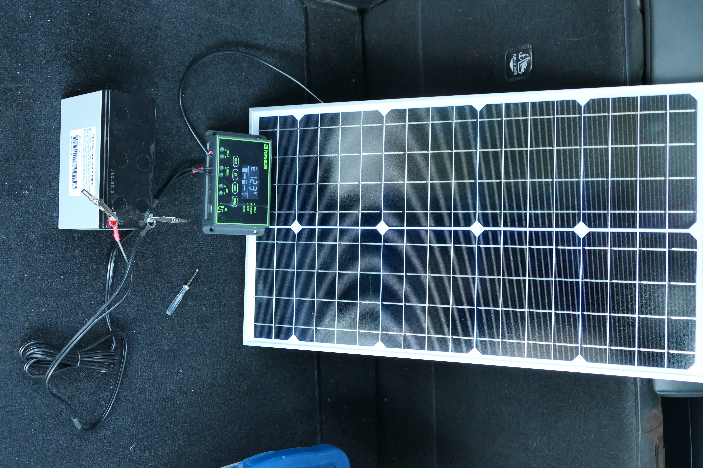
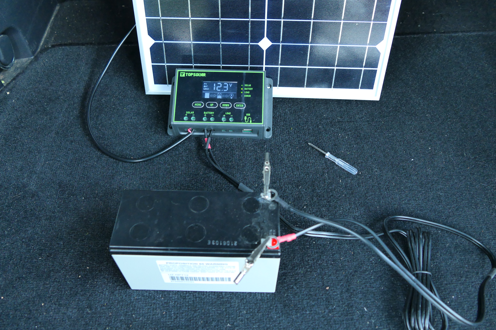
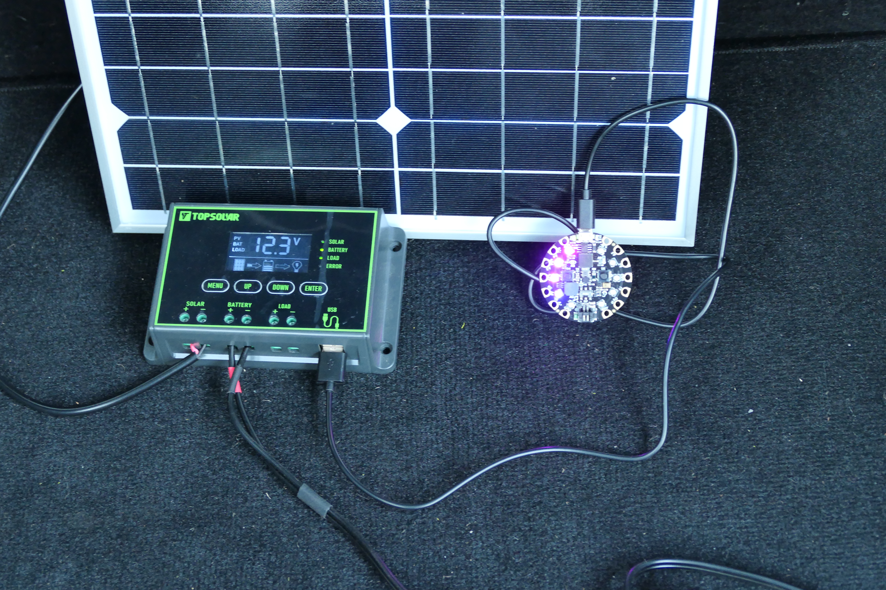
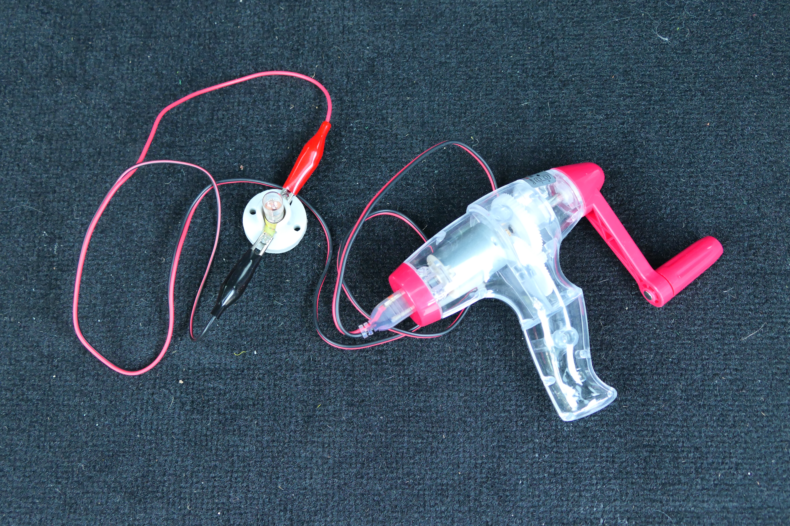
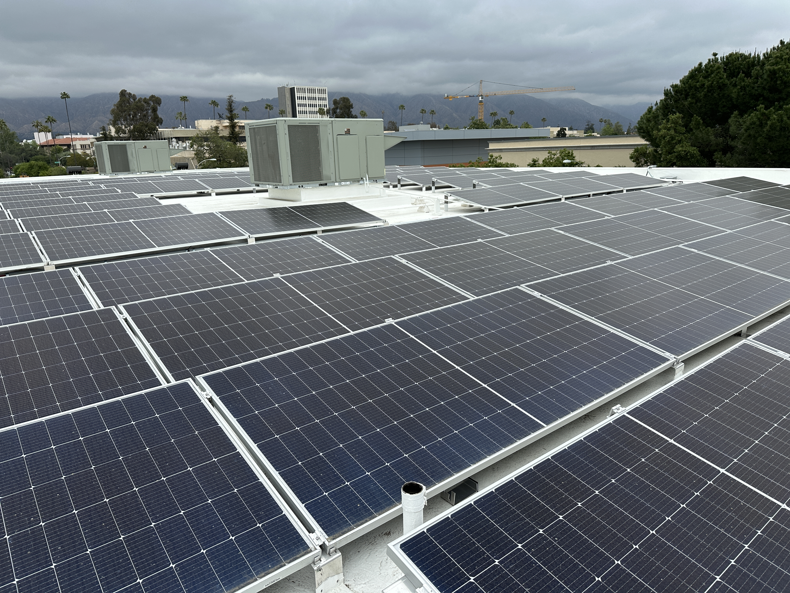
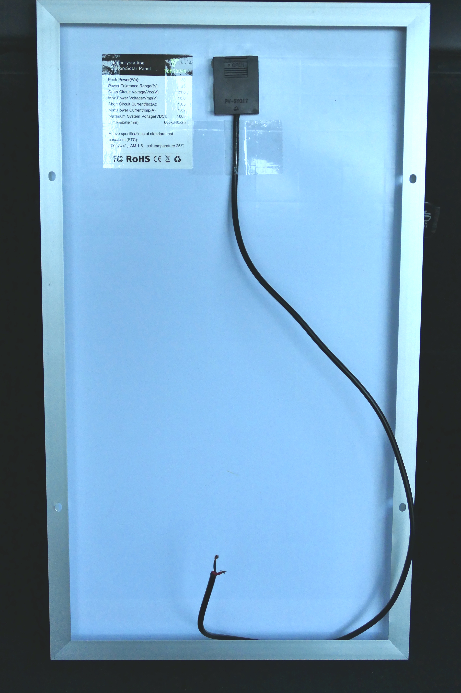

Solar Panel Demonstration (4th graders)
========================================

### by Richard White, rwhite@crashwhite.com

Description
-----------

This document describes a short demonstration on solar cells and solar energy, prepared for a 4th grade classroom.

Materials
---------

See photos of materials at end of docoment

1. Solar panel connected to controller (w/USB-A plug), 12-volt motorcycle battery
2. Circuit Playground Express with sound meter program running, plugged into phone charger above
3. Genecon generator, wires, light bulb, capacitor (borrowed from Upper School Physics stockroom)
4. Midland emergency radio (with crank, solar cell, battery)

Setup
-----

Before the presentation, the solar panel should be connected to the battery and controller as shown in the diagram at the end of this document. *Take care that the positive and negative terminals of the battery are not connected directly to each other with any conductor!* For safety, the battery should be kept in the large, plastic battery box, although there is educational value in having the battery visible to students where they can identify it.

The round Circuit Playground Express has a "sound meter" program that loads and runs automatically when that unit is plugged into the USB-A port on the solar controller. This unit can be hung over the solar cell where it is visible to students.

Prior to the presentation, students may have questions about the lights and/or the solar panel.

Formal Presentation
-------------------

### People use energy

I wanted to talk to you about electrical energy, and the generation of power that we use to run much of our world. 

Unless we're camping or backpacking, we are almost always using electricity: for our lights, our cars, our phones, our laptops... We flip a switch and electricity flows into our homes, or we press a button and our phones, computers, Internet, and TVs light up. 

**Where does that energy come from?**

### 1. Generators

Most of our energy comes from moving a wire coil in a magnetic field, using something called a *generator*. Turn the coil, and mechanical energy is converted to electrical energy. How can we turn a generator?

1. You can turn the generator by hand

    1. Emergency radio has batteries that can be charged with this hand crank. (Demonstrate Midland radio)
    2. GeneCon generator demonstrates rotational mechanical energy being converted to electricity. (Demonstrate cranking handle causes the light bulb to light.)

2. You can turn the generator using some other source
    
    1. Use a windmill. (Maybe you've seen some of these on a drive to Joshua Tree, or Palm Springs, or San Francisco.)
    2. Use water (a river or tides).
    
3. The most common way is to heat water to make steam pressure which will force a turbine to rotate. How can we heat the water?

    1. Burn coal.
    2. Burn oil.
    3. Start a nuclear reaction.
    
### 2. Solar cells

A solar cell does not use a generator!

In a *solar cell*, light hitting special types of panels has enough energy to cause electrons to move, which creates a current in circuits connected to the panel.

Where do we see solar cells or solar panels?

* The roofs of people's houses.
* "Solar farms" located out in open areas.
* Here's one! It's hooked up to a controller, a battery, and whatever else it is that you want to power. The controller automatically switches the circuit so that when the solar cell is making energy, it can power a device and/or charge the battery. And when it's not making energy (it's too dark), the battery can deliver enegy to the device to keep it running.
* This emergency radio can be powered by batteries, or a generator, or solar cells!
* The roof of our gym?! 

Conclusion
----------

Laura Fleming closes up with information about how Poly uses that energy.

Photos
------

<figure><figcaption>Solar cell connected to battery and controller. Ensure that red wires are connect to red (+) terminal, and black wires are connected to black (-) terminals.</figcaption></figure>
<figure><figcaption>Close-up of controller connections</figcaption></figure>
<figure><figcaption>Circuit Playground Express plugged into USB port on controller</figcaption></figure>
<figure><figcaption>Genecon demo</figcaption></figure>
<figure><figcaption>Solar array on the roof of the Poly gym</figcaption></figure>
<figure><figcaption>Back of solar cell with specifications</figcaption></figure>

